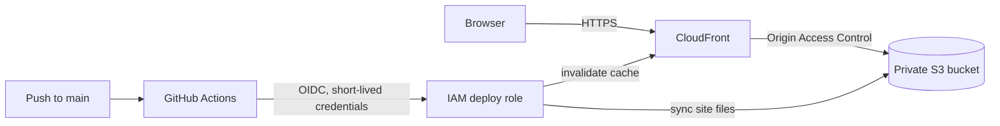

# Pokémon Team Builder

Build a team, see what it's actually weak to, and check it against the competitive meta.


**[Live demo](https://YOUR-DISTRIBUTION-DOMAIN.cloudfront.net)**

## Why

Planning a competitive team means juggling type coverage, synergy and the current meta, and I couldn't find a free tool that checked all three. I built one, and it was my first real project against a live REST API.

## What it does

- **Net weaknesses, not raw ones.** Listing each Pokémon's weaknesses is easy. The useful question is what the team is weak to. If one teammate resists a type another is weak to, that hole is covered. I multiply each attacking type against every teammate's types using a local 18×18 type chart, and highlight the types where more of the team is weak than resistant.
- **Abilities change the math.** Wonder Guard, Flash Fire and friends adjust the damage multipliers, and adjusted cells are marked with `*`.
- **Meta check.** One button scans your team against 8 top competitive threats. A teammate counts as an answer if its types hit the threat super effectively or resist everything the threat can do. Otherwise you get "No Counter". The report flags itself as stale when you change the team.
- **Showdown export.** Copies your team as Pokémon Showdown paste text. For now it's species and ability only, with no moves or EVs.
- **Saved without an account.** Your team lives in `localStorage` and survives refreshes. Teams saved by older versions get migrated on load.

## What I learned

- A thousand sequential requests is a frozen page. The Pokédex loads all 1,025 Pokémon with `async/await` and `Promise.all()` in batches of 250, with a progress bar. Each Pokémon is cached in `localStorage`, so repeat visits skip the network.
- Type matchups live in a local `typeChart.js`, so the weakness chart doesn't hit the API on every render. I used to re-fetch them each time, which was wasteful and slow.
- The hard part was never the fetching. It was deciding what "weak" means for a team and not for one Pokémon.

## Known limits

- The threat scan only looks at types, not movesets.
- The threat list in `metaPokemon.js` is static, so it ages as the meta moves.
- Cached Pokémon never expire.

## Stack

Vanilla JavaScript, HTML, CSS and [PokeAPI](https://pokeapi.co). Hosted on AWS (S3, CloudFront) and deployed by GitHub Actions. Also deployed on Vercel.

## Deployment

The site is static, so hosting is a private S3 bucket behind CloudFront. Every push to `main` deploys it through GitHub Actions.



**Hosting**
- The S3 bucket has Block Public Access on. Requesting an object from the S3 URL directly returns `AccessDenied`.
- CloudFront is the only reader. It reaches the bucket through Origin Access Control, and the bucket policy allows only this one distribution.
- CloudFront serves the site over HTTPS, and HTTP requests redirect to HTTPS.

**CI/CD**
- `.github/workflows/deploy.yml` runs on every push to `main`. It syncs the site files to S3 and then invalidates the CloudFront cache, so changes go live without manual steps.
- Only `.html`, `.css` and `.js` files are uploaded, so `README.md`, `.git` and the workflow folder never reach the bucket.
- GitHub authenticates to AWS with OIDC. There are no access keys stored in GitHub. Each run gets temporary credentials from an IAM role.

**Security choices**
- The role's trust policy accepts tokens only from this repository's `main` branch. I tested it by running the workflow from another branch, and AWS refused to issue credentials.
- The role's permissions are limited to listing, writing and deleting objects in this one bucket, and creating invalidations on this one distribution.
- Resources are tagged `project=pokemon-team-builder`.

Region is us-east-2. The app still calls PokeAPI directly from the browser. A caching API in front of it is the next planned step.

## Run it locally

```
git clone https://github.com/lviss-1/Pokemon-Team-Builder
cd Pokemon-Team-Builder
open index.html
```

No build step. It's a static site that talks straight to PokeAPI.
